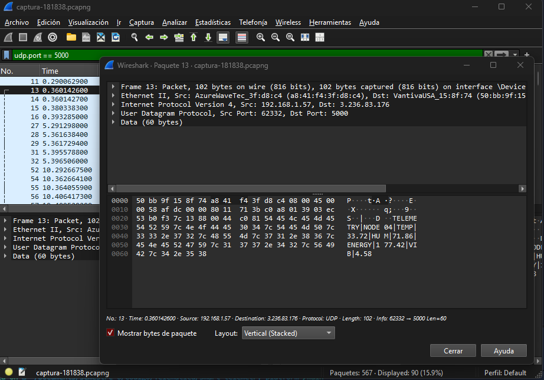
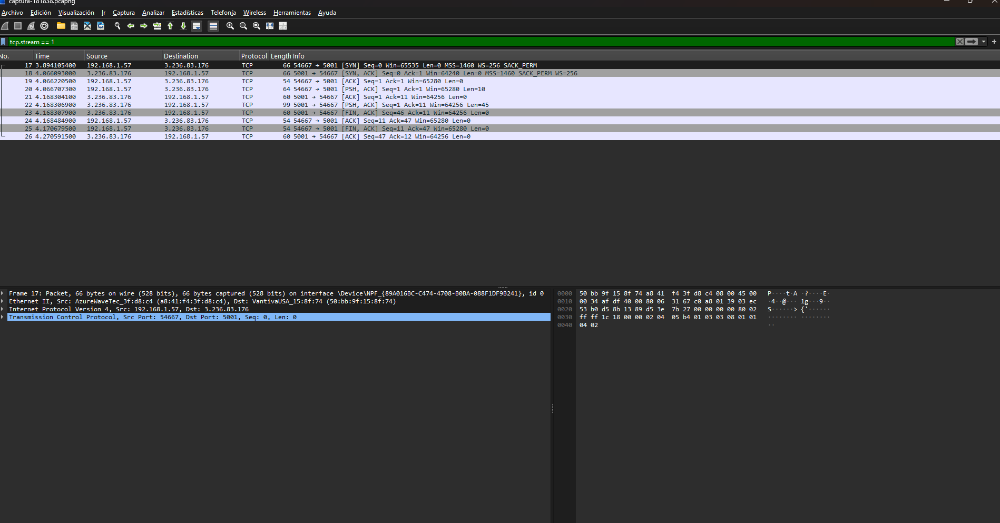
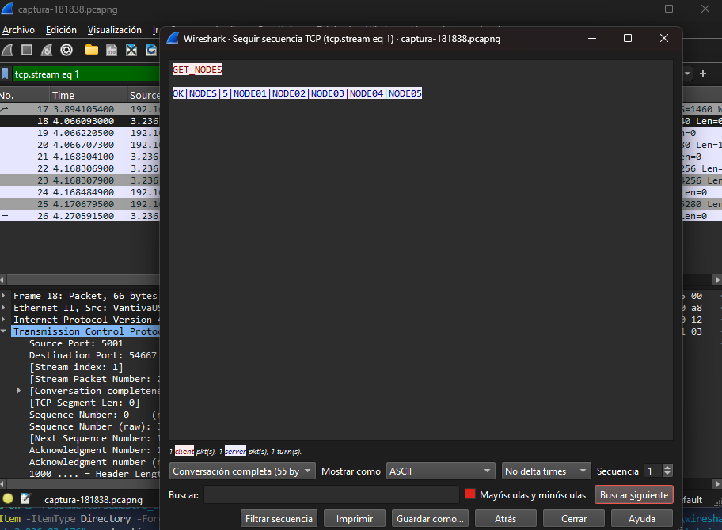
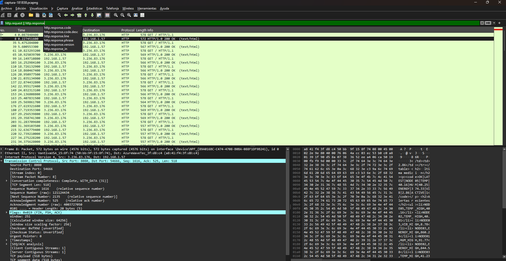
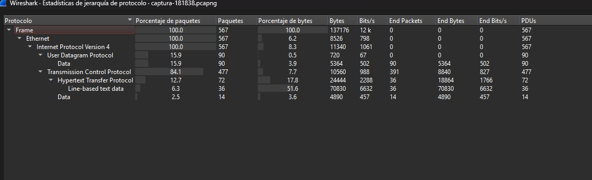
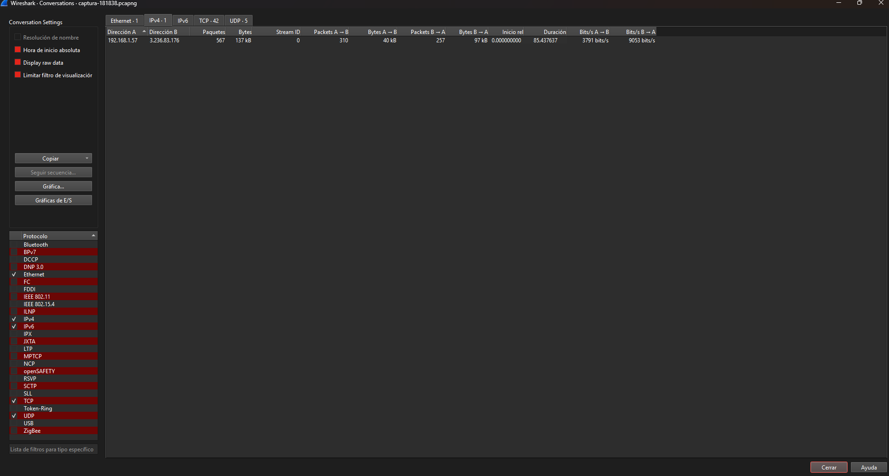

# Análisis de tráfico con Wireshark

**Fecha de la captura:** 20 de septiembre de 2026
**Archivo de evidencia:** `docs/assets/wireshark/captura-181838.pcapng`

## 1. Condiciones de la captura

La captura se realizó desde un equipo con Windows conectado a Internet por Wi-Fi, mientras el servidor central se ejecutaba dentro del contenedor Docker desplegado en la instancia EC2. No se capturó tráfico de loopback ni de interfaces virtuales: la interfaz seleccionada fue el adaptador físico `Wi-Fi`, de modo que todos los paquetes registrados atravesaron efectivamente Internet.

Para limitar el registro al tráfico del proyecto se aplicó el filtro de captura `host 3.236.83.176`, que descarta cualquier paquete ajeno a la comunicación con el servidor. La sesión duró 85,44 segundos y registró **567 paquetes con 137 176 bytes**.

Durante la captura se ejecutaron simultáneamente los cinco nodos de telemetría, se realizaron seis consultas desde el cliente operador y se recargó varias veces el panel web en el navegador, de forma que la misma captura contiene los tres tipos de comunicación del sistema.

Las direcciones involucradas son las siguientes. El equipo cliente aparece con la dirección privada `192.168.1.57`, asignada por el router de la red local. El servidor aparece con la dirección pública `3.236.83.176`, correspondiente al nombre `ec2-3-236-83-176.compute-1.amazonaws.com` resuelto por DNS.

Conviene advertir una diferencia que se observa al comparar la captura con la configuración del Security Group en AWS. Wireshark registra como origen la dirección privada `192.168.1.57`, mientras que el servidor en AWS recibe los paquetes desde la dirección pública `181.132.86.197`. La discrepancia no es un error: el router de la red doméstica aplica traducción de direcciones (NAT) después de que el paquete abandona la tarjeta de red del equipo, por lo que la captura local solo puede observar el direccionamiento previo a esa traducción. Es una manifestación directa del comportamiento de la capa de red en un escenario real.

## 2. Figura 1. Datagrama de telemetría sobre UDP

**Filtro de visualización aplicado:** `udp.port == 5000`



**Figura 1.** Detalle del paquete 13, correspondiente a una medición enviada por el nodo `NODE04`. Se observan las tres capas involucradas y el mensaje del protocolo de aplicación legible en el panel de bytes.

El filtro aísla los 90 datagramas de telemetría registrados, que corresponden al `15,9 %` del total capturado. Esa cifra concuerda con el comportamiento esperado del sistema: cinco nodos emitiendo una medición cada cinco segundos durante noventa segundos producen exactamente noventa datagramas.

En la **capa de red** la cabecera IPv4 identifica el origen `192.168.1.57` y el destino `3.236.83.176`. En la representación hexadecimal esas direcciones aparecen como `c0 a8 01 39` y `03 ec 53 b0`. El byte `11` de esa misma cabecera es el campo *Protocol* y vale 17 en decimal, valor que el estándar asigna a UDP; es decir, la propia capa de red declara cuál será el protocolo de transporte antes de que este se procese.

En la **capa de transporte** la cabecera UDP indica el puerto de origen `62332`, asignado dinámicamente por el sistema operativo al nodo, y el puerto de destino `5000`, que en hexadecimal se lee como `13 88` y es el puerto donde el servidor mantiene su socket en escucha. La cabecera declara una longitud total de 68 bytes, de los cuales 8 corresponden a la propia cabecera UDP y 60 al contenido transportado.

En la **capa de aplicación** esos 60 bytes contienen el mensaje completo del protocolo diseñado para el proyecto:

```text
TELEMETRY|NODE04|TEMP|33.72|HUM|71.86|ENERGY|177.42|VIB|4.58
```

El mensaje viaja en texto ASCII plano y puede leerse sin ninguna decodificación en la columna derecha del panel de bytes. Esta característica permite verificar visualmente la correspondencia entre la especificación del protocolo y lo que realmente circula por la red.

Debe subrayarse lo que **no** aparece en esta figura. No hay establecimiento previo de conexión, no hay confirmación de recepción y no hay cierre. Cada datagrama constituye una transmisión completa e independiente. Si uno se pierde en el trayecto, ningún mecanismo lo retransmite y ninguno de los dos extremos se entera. Esa es precisamente la propiedad que hace a UDP apropiado para telemetría periódica: la pérdida ocasional de una medición resulta irrelevante porque cinco segundos después llega una lectura más reciente que la sustituye.

## 3. Figura 2. Establecimiento y cierre de una conexión TCP

**Filtro de visualización aplicado:** `tcp.stream == 1`



**Figura 2.** Ciclo de vida completo de una consulta del operador, desde el establecimiento de la conexión hasta su cierre, en los paquetes 17 a 26.

El filtro aísla una única conversación TCP contra el puerto 5001. La columna *Info* de Wireshark muestra el intercambio completo en diez paquetes, cuya secuencia se resume a continuación.

| Paquete | Sentido | Indicadores | Datos |
|---:|---|---|---:|
| 17 | cliente → servidor | `SYN` | 0 |
| 18 | servidor → cliente | `SYN, ACK` | 0 |
| 19 | cliente → servidor | `ACK` | 0 |
| 20 | cliente → servidor | `PSH, ACK` | 10 |
| 21 | servidor → cliente | `ACK` | 0 |
| 22 | servidor → cliente | `PSH, ACK` | 45 |
| 23 | servidor → cliente | `FIN, ACK` | 0 |
| 24 | cliente → servidor | `ACK` | 0 |
| 25 | cliente → servidor | `FIN, ACK` | 0 |
| 26 | servidor → cliente | `ACK` | 0 |

Los paquetes 17, 18 y 19 constituyen el **establecimiento de conexión mediante el acuerdo de tres vías**. El cliente solicita la conexión con el indicador `SYN` y un número de secuencia inicial; el servidor responde confirmando esa solicitud y enviando la suya con `SYN, ACK`; el cliente confirma la del servidor con `ACK`. A partir del paquete 19 existe un canal fiable y bidireccional entre el puerto efímero `54667` del cliente y el puerto `5001` del servidor.

Los paquetes 20 a 22 transportan la información útil. El paquete 20 lleva 10 bytes, que corresponden al comando `GET_NODES` seguido del salto de línea que el protocolo exige como terminador. El paquete 22 lleva 45 bytes con la respuesta. Entre ambos, el paquete 21 es una confirmación pura sin datos, emitida por el servidor para acusar recibo del comando.

Los paquetes 23 a 26 realizan el cierre ordenado. Resulta significativo que sea el **servidor** quien inicia el cierre en el paquete 23, y no el cliente: ese comportamiento refleja fielmente el diseño implementado en `server/src/tcp_server.c`, donde el hilo que atiende a cada operador procesa un único comando, envía la respuesta y cierra el descriptor. Cada opción del menú del cliente operador abre por tanto su propia conexión, lo que explica que la captura registre seis acuerdos de tres vías para seis consultas.

## 4. Figura 3. El protocolo de aplicación sobre TCP

**Procedimiento:** clic derecho sobre un paquete del flujo → *Follow* → *TCP Stream*



**Figura 3.** Reconstrucción del diálogo de la capa de aplicación correspondiente al flujo de la Figura 2, con el comando del operador y la respuesta del servidor.

La función *Follow TCP Stream* reensambla el contenido transportado por la conexión y descarta las cabeceras, de modo que se observa únicamente el intercambio tal como lo perciben las aplicaciones en cada extremo:

```text
GET_NODES
OK|NODES|5|NODE01|NODE02|NODE03|NODE04|NODE05
```

La solicitud aparece en un color y la respuesta en otro, lo que permite distinguir el sentido de cada mensaje. La respuesta confirma que en ese instante el servidor tenía registrados cinco nodos activos, coherente con los cinco procesos en ejecución.

Esta figura documenta el cumplimiento del requisito de diseñar un protocolo propio de capa de aplicación. El comando sigue la estructura especificada en `docs/protocol.md`: un identificador de operación, parámetros separados por el carácter `|` cuando existen, y terminación con salto de línea. La respuesta se ajusta al mismo formato, encabezada por el indicador de resultado `OK`.

## 5. Figura 4. Tráfico HTTP del panel web

**Filtro de visualización aplicado:** `http.request || http.response`



**Figura 4.** Peticiones y respuestas HTTP intercambiadas con el panel web durante la captura, con el contenido de una respuesta visible en el panel de bytes.

El filtro aísla las 72 tramas correspondientes al servicio web, repartidas en 36 peticiones `GET /` y sus 36 respuestas `HTTP/1.0 200 OK` con contenido `text/html`. El elevado número de peticiones se explica porque la página incluye una instrucción de recarga automática cada cinco segundos, además de las recargas manuales realizadas durante la prueba.

El aspecto más relevante de esta figura no es el intercambio HTTP en sí, sino lo que se observa dentro del cuerpo de la respuesta. En el panel de bytes puede leerse, incrustado en el código HTML que el servidor devuelve al navegador, el siguiente fragmento:

```text
OK|LATEST|NODE05|TEMP|40.16|HUM|40.25|ENERGY|374.33|VIB|2.86|ACTIVE|1
```

Se trata de una respuesta del protocolo propio, transportada literalmente dentro de la página web. El panel no consulta una base de datos ni accede al estado del servidor por ningún mecanismo alternativo: abre una conexión TCP contra el puerto 5001, emite los mismos comandos que utiliza el cliente operador, y compone la página con las respuestas obtenidas. HTTP cumple aquí exclusivamente la función de presentar información en el navegador, mientras la comunicación sustantiva del sistema continúa realizándose mediante el protocolo diseñado por el equipo.

## 6. Figura 5. Jerarquía de protocolos

**Menú:** *Estadísticas → Jerarquía de protocolo*, sin filtro de visualización aplicado



**Figura 5.** Distribución de los 567 paquetes capturados entre los protocolos de cada capa.

La tabla presenta el encapsulamiento completo de la pila TCP/IP tal como se observó durante la prueba. La totalidad de las tramas Ethernet transportan paquetes IPv4, y estos se reparten entre los dos protocolos de transporte del sistema:

| Protocolo | Paquetes | Porcentaje | Paquetes terminales |
|---|---:|---:|---:|
| UDP | 90 | 15,9 % | 0 |
| TCP | 477 | 84,1 % | 391 |
| HTTP (sobre TCP) | 72 | 12,7 % | 36 |
| `Data` sobre TCP | 14 | 2,5 % | 14 |

La columna de paquetes terminales merece atención especial, pues cuantifica los paquetes en los que el protocolo indicado constituye el nivel más alto alcanzado, es decir, aquellos que **no transportan datos de aplicación**.

En TCP ese valor asciende a **391 de 477 paquetes**, un 82 % del tráfico TCP capturado. Se trata de acuerdos de conexión, confirmaciones y cierres: el precio que el protocolo cobra por garantizar entrega, orden e integridad. Solo 86 paquetes TCP transportan contenido real, de los cuales 72 corresponden a HTTP y 14 al protocolo del proyecto.

En UDP ese valor es **cero**. Los noventa datagramas transportan, sin excepción, una medición de telemetría.

Esta comparación constituye la justificación cuantitativa de la elección de transporte realizada en el diseño. Si la telemetría se hubiese implementado sobre TCP, cada medición habría requerido establecer y cerrar una conexión, multiplicando aproximadamente por diez el número de paquetes necesarios para entregar la misma información, a cambio de una garantía que la aplicación no necesita. Las consultas del operador, en cambio, sí exigen que el comando llegue íntegro y que la respuesta se reciba completa y en orden, por lo que en su caso el costo se justifica.

Una observación adicional respalda el cumplimiento del requisito de protocolo propio. Wireshark identifica HTTP por su nombre e incluso extrae sus líneas de texto, porque se trata de un protocolo estándar cuyo disector conoce. En cambio, los 14 paquetes que transportan el protocolo del proyecto aparecen clasificados genéricamente como `Data`: el analizador reconoce que hay información de aplicación, pero no dispone de ningún disector capaz de interpretarla, precisamente porque el protocolo fue diseñado por el equipo y no corresponde a ningún estándar existente.

Los 4 890 bytes concentrados en esos 14 paquetes se explican por la consulta `GET_ALERTS`, cuya respuesta incluye las cien alertas conservadas en el búfer circular del servidor.

## 7. Figura 6. Conversación entre los extremos

**Menú:** *Estadísticas → Conversations*, pestaña IPv4, sin limitar al filtro de visualización



**Figura 6.** Resumen de la única conversación IPv4 registrada, entre el equipo cliente y la instancia desplegada en la nube.

La captura registra una sola conversación a nivel de red, consecuencia directa del filtro `host 3.236.83.176` aplicado durante la captura. Sus cifras son las siguientes:

| Sentido | Paquetes | Bytes |
|---|---:|---:|
| Cliente → servidor | 310 | 40 kB |
| Servidor → cliente | 257 | 97 kB |
| **Total** | **567** | **137 kB** |

El tráfico resulta marcadamente asimétrico, y en sentido inverso al que podría suponerse. El cliente emite más paquetes que el servidor, porque los cinco nodos generan un flujo constante de datagramas; sin embargo transfiere menos de la mitad de los bytes, dado que cada medición ocupa apenas 60 bytes. El servidor emite menos paquetes pero transporta más del doble de información, porque sus respuestas incluyen páginas HTML completas y listados de cien alertas.

La duración registrada de 85,44 segundos coincide con la ventana de captura programada, lo que confirma que el tráfico se distribuyó de manera continua a lo largo de toda la prueba y no se concentró en ráfagas.

## 8. Correspondencia con las capas del modelo TCP/IP

Las figuras anteriores permiten recorrer la pila completa sobre tráfico real del sistema.

En la **capa de aplicación** operan tres protocolos distintos. El protocolo de telemetría, orientado a la emisión unidireccional de mediciones, se observa en la Figura 1. El protocolo de consultas, orientado a la interacción entre operador y servidor, se observa en la Figura 3. Y HTTP, empleado exclusivamente para la presentación en el navegador, se observa en la Figura 4. Los dos primeros fueron diseñados por el equipo; el tercero se integra como capa de presentación sobre ellos.

En la **capa de transporte** conviven UDP y TCP con funciones deliberadamente diferenciadas, cuantificadas en la Figura 5. UDP transporta la telemetría en datagramas independientes sin garantía de entrega. TCP transporta las consultas del operador y el tráfico web, estableciendo conexiones cuyo ciclo completo documenta la Figura 2. Los puertos 5000, 5001 y 8080 identifican los tres servicios dentro del mismo equipo.

En la **capa de red** IPv4 encamina todos los paquetes entre la red doméstica del cliente y el centro de datos de AWS en Virginia, empleando el campo *Protocol* de la cabecera para indicar en cada caso cuál de los dos protocolos de transporte transporta. La Figura 6 resume el volumen total intercambiado entre ambos extremos, y la diferencia entre la dirección privada observada localmente y la dirección pública registrada por el servidor evidencia la traducción de direcciones intermedia.

## 9. Resultados verificables

La captura permite sostener las siguientes afirmaciones con evidencia directa. El sistema emplea efectivamente los dos protocolos de transporte exigidos, en la proporción de 90 datagramas UDP frente a 477 segmentos TCP. El establecimiento de conexión TCP mediante acuerdo de tres vías queda documentado en los paquetes 17 a 19. Los datagramas UDP transportan mediciones completas e independientes sin mecanismo alguno de confirmación. El protocolo de aplicación diseñado por el equipo circula en texto plano y resulta legible dentro del contenido de los paquetes, tanto sobre UDP como sobre TCP. Y la comunicación se produjo entre equipos situados en redes distintas, a través de Internet, contra un servidor localizado mediante nombre DNS.
