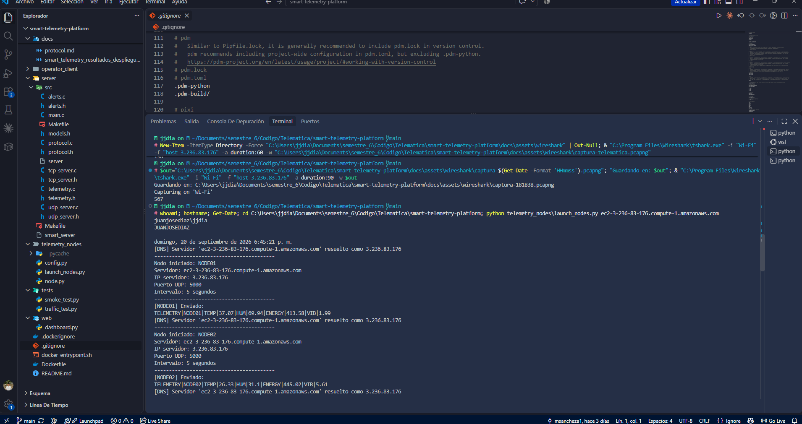
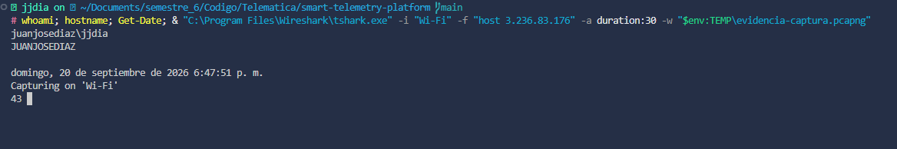

# Evidencias individuales — Juan José Díaz

**Fecha de ejecución:** 20 de septiembre de 2026
**Equipo:** `JUANJOSEDIAZ` · usuario `juanjosediaz\jjdia`
**Aporte en el proyecto:** captura y análisis de tráfico de red con Wireshark (sección 8 del informe técnico).

Las capturas de pantalla que siguen fueron tomadas en el equipo indicado, ejecutando componentes del sistema contra el servidor desplegado en la instancia EC2. En ambas se muestran, en la misma terminal, los comandos de identificación (`whoami`, `hostname`, `Get-Date`) seguidos de la ejecución correspondiente.

## Evidencia 1. Ejecución de los nodos de telemetría contra la nube

**Evidencia 1.** Terminal integrada de Visual Studio Code sobre el repositorio del proyecto, con la ejecución de los cinco nodos de telemetría dirigidos al servidor en AWS.

La imagen permite verificar el usuario `juanjosediaz\jjdia`, el hostname `JUANJOSEDIAZ` y la marca temporal del domingo 20 de septiembre de 2026 a las 6:45 p. m. El explorador de archivos muestra la estructura del proyecto, incluidos los fuentes del servidor en C y los módulos de Python.

La ejecución de `launch_nodes.py` produce la línea `[DNS] Servidor 'ec2-3-236-83-176.compute-1.amazonaws.com' resuelto como 3.236.83.176`, que documenta la localización del servidor mediante nombre DNS y no mediante una dirección fija. A continuación se observan los mensajes de telemetría efectivamente transmitidos, por ejemplo `TELEMETRY|NODE01|TEMP|37.07|HUM|69.94|ENERGY|413.58|VIB|1.99`.

## Evidencia 2. Captura de tráfico con Wireshark

**Evidencia 2.** Ejecución de `tshark` capturando tráfico en vivo sobre la interfaz física `Wi-Fi`, filtrado a la dirección del servidor desplegado.

La imagen corresponde al aporte individual en el proyecto. Se observan nuevamente los datos de identificación del equipo, con marca temporal de las 6:47 p. m., y el prompt indica el directorio del repositorio y la rama `main`.

El filtro de captura `host 3.236.83.176` restringe el registro al tráfico intercambiado con la instancia EC2, y el contador muestra 43 paquetes capturados en el momento de la toma. La interfaz seleccionada es el adaptador físico `Wi-Fi`, lo que confirma que la captura corresponde a tráfico real a través de Internet y no a tráfico local o de interfaces virtuales.

El análisis completo de la captura definitiva, con seis figuras y su interpretación por capas, se encuentra en [analisis-trafico-wireshark.md](analisis-trafico-wireshark.md).
