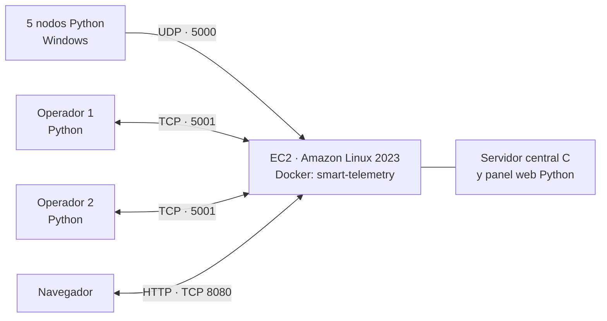
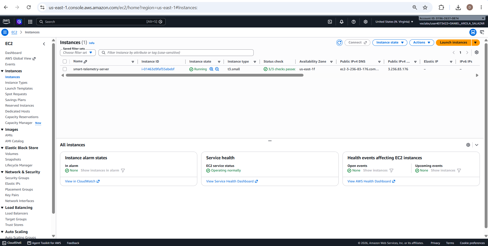
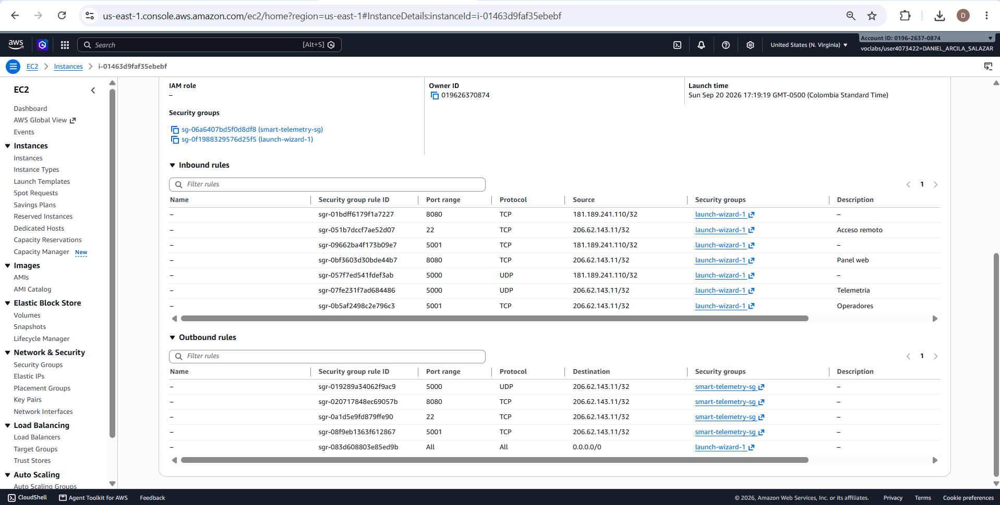

# Smart Telemetry Platform — Informe de despliegue y pruebas

**Fecha de ejecución documentada:** 20 de septiembre de 2026  
**Entorno:** AWS Academy Learner Lab · Amazon EC2 · Amazon Linux 2023 · Docker  
**Estado:** despliegue funcional y pruebas de aplicación realizadas; capturas Wireshark pendientes a cargo de otro integrante.

> **Alcance de este informe.** Los resultados provienen de las salidas de consola y capturas compartidas durante la sesión. Se distingue entre resultados observados, configuraciones comunicadas y evidencias que todavía no se han aportado. No se sustituyen resultados reales por valores simulados.

## 1. Arquitectura implementada



El servidor central en C y el panel web en Python se ejecutan dentro de un mismo contenedor en EC2. Los nodos y operadores se ejecutan desde computadores externos. El panel se consulta desde un navegador mediante el DNS público de la instancia.

## 2. Datos del despliegue

| Elemento | Valor documentado |
|---|---|
| Nombre previsto de instancia | `smart-telemetry-server` |
| Región comprobada | `us-east-1` (N. Virginia) |
| Zona de disponibilidad | `us-east-1f` |
| Tipo de instancia | `t3.small` |
| ID de instancia | `i-01463d9faf35ebebf` |
| Sistema operativo comprobado | Amazon Linux 2023.12.20260918 |
| Usuario SSH | `ec2-user` |
| Hostname interno observado | `ip-172-31-71-212.ec2.internal` |
| DNS público inicial | `ec2-44-192-90-37.compute-1.amazonaws.com` |
| IPv4 pública inicial comprobada por DNS | `44.192.90.37` |
| DNS público utilizado posteriormente | `ec2-3-236-83-176.compute-1.amazonaws.com` |
| IPv4 pública posterior, observada en los nodos | `3.236.83.176` |
| Imagen Docker | `smart-telemetry:v1` |
| ID abreviado de imagen | `9bcc2f78be3b` |
| Tamaño de imagen informado | `124MB` |
| Contenedor | `smart-telemetry` |
| ID abreviado de contenedor | `842482fdbb8f` |
| Commit empaquetado para el despliegue | `27153821ae2be37da6206de4a2af8c92c0ed738d` |
| Puertos publicados | UDP `5000`, TCP `5001`, TCP `8080` |
| Estado observado de la instancia | `Running`, con `3/3 checks passed` |

**Cambio de DNS:** el usuario informó que cambió el DNS público durante el trabajo. Las pruebas posteriores se realizaron con `ec2-3-236-83-176.compute-1.amazonaws.com`. La captura de la consola EC2 confirma que la instancia `i-01463d9faf35ebebf` estaba activa con la IPv4 pública `3.236.83.176`, por lo que queda documentada la asociación de la dirección usada en las pruebas con la instancia desplegada.



**Figura 1.** Instancia `smart-telemetry-server` en la región N. Virginia, zona `us-east-1f`, con ID `i-01463d9faf35ebebf`, tipo `t3.small`, estado `Running`, comprobaciones `3/3` e IPv4 pública `3.236.83.176`.

### 2.1. Security Group

Se informó la creación y asociación del grupo `smart-telemetry-sg`. La guía establece estas reglas de entrada:

| Servicio | Protocolo | Puerto | Origen previsto |
|---|---|---:|---|
| Acceso SSH | TCP | 22 | IP pública del administrador `/32` |
| Telemetría | UDP | 5000 | IP pública de cada integrante `/32` |
| Consultas de operadores | TCP | 5001 | IP pública de cada integrante `/32` |
| Panel web | TCP | 8080 | IP pública de cada integrante `/32` |

La instancia tiene asociados los grupos `smart-telemetry-sg` y `launch-wizard-1`. La captura de la consola acredita reglas de entrada para TCP 22, TCP 5001, TCP 8080 y UDP 5000, limitadas a las direcciones públicas `181.189.241.110/32` y `206.62.143.11/32`, según el servicio requerido. Las pruebas externas acreditan conectividad por TCP 22, 5001 y 8080, además de recepción funcional de telemetría por UDP 5000.



**Figura 2.** Grupos de seguridad asociados y reglas de entrada visibles para acceso remoto, telemetría, consultas de operadores y panel web. Los orígenes `/32` restringen el acceso a las direcciones públicas de los equipos participantes.

## 3. Preparación y publicación de la aplicación

### 3.1. Resolución de DNS y acceso SSH

Desde PowerShell, el DNS inicial resolvió correctamente:

```text
Resolve-DnsName $ServidorDns -Type A
... IPAddress: 44.192.90.37
```

La conexión al puerto 22 devolvió:

```text
Test-NetConnection $ServidorDns -Port 22
TcpTestSucceeded : True
```

Se estableció una sesión SSH mediante la llave `smart-telemetry-key.pem`; `whoami` devolvió `ec2-user`, y `/etc/os-release` identificó Amazon Linux 2023.12.20260918.

### 3.2. Instalación de Docker

En EC2 se ejecutaron:

```bash
sudo dnf install -y docker
sudo systemctl enable --now docker
sudo docker version
sudo systemctl is-active docker
```

**Resultado observado:** instalación finalizada con `Complete!`; Docker Server/Engine `25.0.16`, cliente `25.0.14` y estado del servicio `active`.

### 3.3. Transferencia del código

Se utilizó el método de la guía basado en `git archive` + `scp`, sin almacenar credenciales del repositorio privado en EC2:

```powershell
$Commit = git rev-parse HEAD
$Paquete = Join-Path $env:TEMP "smart-telemetry.tar"
git archive --format=tar --output="$Paquete" HEAD
scp -i "$Llave" "$Paquete" "ec2-user@${ServidorDns}:/home/ec2-user/smart-telemetry.tar"
```

El `git status --short` inicial no mostró cambios pendientes. En EC2 se extrajo el archivo en `/home/ec2-user/smart-telemetry-platform`. El listado `ls -la` confirmó la presencia de `Dockerfile`, `docker-entrypoint.sh`, `server/`, `web/`, `telemetry_nodes/`, `operator_client/` y `tests/`.

### 3.4. Construcción y ejecución del contenedor

```bash
sed -i 's/\r$//' docker-entrypoint.sh
sudo docker build -t smart-telemetry:v1 .
sudo docker image ls smart-telemetry
```

**Resultado observado:** compilación finalizada con `Building 28.0s (16/16) FINISHED`; imagen `smart-telemetry:v1`, ID abreviado `9bcc2f78be3b`, tamaño `124MB`.

El contenedor se inició con:

```bash
sudo docker run -d \
  --name smart-telemetry \
  --restart unless-stopped \
  -e PYTHONUNBUFFERED=1 \
  -p 5000:5000/udp \
  -p 5001:5001/tcp \
  -p 8080:8080/tcp \
  smart-telemetry:v1
```

`sudo docker ps` mostró el contenedor `Up` y los tres puertos publicados. La prueba local:

```bash
curl -s -o /dev/null -w '%{http_code}\n' http://localhost:8080/
```

respondió `200`. El comando `sudo docker logs --tail 50 smart-telemetry` no mostró líneas en la salida compartida; esto por sí solo no equivale a un fallo.

## 4. Pruebas funcionales y resultados

| N.º | Prueba | Resultado observado | Estado |
|---:|---|---|---|
| 1 | Resolución DNS inicial | DNS resuelto a `44.192.90.37` | Correcta |
| 2 | Conectividad SSH | `TcpTestSucceeded : True` en puerto 22; sesión SSH iniciada | Correcta |
| 3 | Docker | Instalación exitosa; servicio `active` | Correcta |
| 4 | Construcción de imagen | `FINISHED`; imagen `smart-telemetry:v1` disponible | Correcta |
| 5 | Contenedor y panel local | Contenedor `Up`; HTTP local `200` | Correcta |
| 6 | TCP externo 5001 | `TcpTestSucceeded : True` | Correcta |
| 7 | TCP externo 8080 | `TcpTestSucceeded : True`; panel abierto en el navegador | Correcta |
| 8 | Cinco nodos UDP | `NODE01`–`NODE05` envían mensajes al puerto 5000; el operador informa cinco nodos activos | Correcta |
| 9 | Consulta de nodos activos | `OK\|NODES\|5\|...` | Correcta |
| 10 | Consulta de nodo específico | `OK\|NODE\|NODE03\|...\|ACTIVE\|1` | Correcta |
| 11 | Última medición | `OK\|LATEST\|NODE05\|...\|ACTIVE\|1` | Correcta |
| 12 | Consulta de alertas y estado | `OK\|ALERTS\|100\|...` y `OK\|SYSTEM\|NODES\|5\|ALERTS\|100` | Correcta |
| 13 | Dos operadores | Ambos equipos obtuvieron respuestas utilizando el DNS actualizado; las salidas no incluyen tiempos que demuestren solapamiento exacto | Funcionamiento individual observado; concurrencia estricta pendiente de evidencia sincronizada |
| 14 | Alerta controlada | Apareció `DEMO_ALERT,TEMP_HIGH,45.00` | Correcta |
| 15 | Prueba de tráfico UDP | 100 transmitidos, 100 recibidos, 0 pérdidas estimadas | Correcta para esa ejecución |
| 16 | Recuperación | Estado pasó de 0 nodos a 5, luego a 0 al detenerlos y nuevamente a 5 al reiniciarlos | Correcta |
| 17 | Capturas Wireshark | Asignadas a otro integrante; no aportadas | Pendiente |

### 4.1. Comunicación TCP con operadores

Se verificó el acceso externo:

```text
Test-NetConnection $ServidorDns -Port 5001
TcpTestSucceeded : True

Test-NetConnection $ServidorDns -Port 8080
TcpTestSucceeded : True
```

El panel web se abrió desde Windows. Las consultas TCP del cliente devolvieron resultados reales, entre ellos:

```text
OK|NODES|5|NODE01|NODE02|NODE03|NODE04|NODE05
OK|NODE|NODE03|TEMP|22.17|HUM|62.64|ENERGY|814.63|VIB|3.19|ACTIVE|1
OK|LATEST|NODE05|TEMP|29.65|HUM|86.05|ENERGY|320.56|VIB|4.91|ACTIVE|1
OK|SYSTEM|NODES|5|ALERTS|100
```

**Incidencia corregida:** al ingresar `3` en lugar de `NODE03`, el servidor respondió `ERROR|NODE_NOT_FOUND`. Repitiendo con el identificador completo `NODE03`, la consulta fue satisfactoria.

**Segunda incidencia corregida:** el primer intento de ejecutar `operator_client/client.py` desde `C:\Users\57318` falló porque no existía allí la ruta relativa. El usuario entró a la raíz del proyecto y ejecutó correctamente el cliente.

### 4.2. Dos operadores y cambio de DNS

Se recibieron salidas satisfactorias del primer operador (nodos, alertas y estado general) y del segundo operador (`NODE03`, últimas mediciones y nodos). Inicialmente se compartieron dos DNS diferentes; después se aclaró el cambio de dirección y el primer operador repitió consultas con el mismo DNS utilizado por el segundo:

```text
ec2-3-236-83-176.compute-1.amazonaws.com
```

**Alcance de la evidencia:** las respuestas de ambos clientes confirman que cada uno pudo consultar el destino común. Para afirmar concurrencia temporal en el informe final, se requieren capturas o registros de consultas superpuestas con marcas de tiempo de ambos equipos.

### 4.3. Alerta controlada

Desde PowerShell se envió un datagrama al puerto UDP 5000 con el mensaje:

```text
TELEMETRY|DEMO_ALERT|TEMP|45|HUM|50|ENERGY|100|VIB|1
```

La consulta de alertas mostró explícitamente:

```text
DEMO_ALERT,TEMP_HIGH,45.00
```

**Interpretación:** el servidor recibió y procesó esa medición, y generó la alerta de temperatura. La salida confirma esta entrega concreta, no una garantía de entrega general de UDP.

### 4.4. Prueba de tráfico UDP

Se ejecutó:

```powershell
python tests/traffic_test.py $ServidorDns
```

Salida observada:

```text
Transmitidos: 100
Recibidos: 100
Pérdidas UDP estimadas: 0
Ejecute la prueba sin otros nodos activos para aislar el conteo.
```

**Resultado:** 100/100 mensajes contabilizados como recibidos y **0 % de pérdidas estimadas en esta ejecución**. Esto no demuestra que UDP garantice entrega ni describe el comportamiento bajo otras cargas o condiciones de red. El script recomienda ejecutar sin otros nodos activos para aislar el conteo; la salida no permite confirmar por sí sola si esa condición se cumplió.

### 4.5. Reinicio, inactividad y recuperación

Tras la prueba de reinicio descrita por el usuario, el operador informó:

```text
OK|SYSTEM|NODES|0|ALERTS|0
```

Esto concuerda con la pérdida de datos almacenados en memoria tras un reinicio, aunque en el registro compartido no aparece la salida del comando `docker restart` ni la de `docker ps` inmediatamente posterior. A continuación se observaron estas transiciones:

```text
OK|NODES|5|NODE01|NODE02|NODE03|NODE04|NODE05
OK|NODES|0
OK|NODES|5|NODE01|NODE02|NODE03|NODE04|NODE05
```

Las consolas de nodos muestran mensajes UDP enviados cada cinco segundos, cierre de sockets y detención manual; al ejecutar nuevamente `launch_nodes.py`, reaparecieron los cinco nodos. **Conclusión acotada:** las consultas confirman la detección de inactividad y la recuperación de nodos; falta adjuntar la evidencia visual del comando de reinicio del contenedor si la rúbrica la exige.

## 5. Evidencias pendientes y responsables

| Evidencia | Responsable / estado |
|---|---|
| Captura de instancia `Running`, ID, región, tipo e IPv4 actual | Anexada como Figura 1 |
| Captura de grupos de seguridad, reglas y orígenes autorizados | Anexada como Figura 2 |
| Capturas de construcción, `docker ps` y HTTP 200 | Salidas registradas; seleccionar capturas |
| Capturas de dos operadores realizando consultas al mismo tiempo con marcas de tiempo | Equipo: pendiente de confirmar |
| Captura de alerta `DEMO_ALERT,TEMP_HIGH,45.00` | Salida registrada; seleccionar captura |
| Captura de tráfico UDP: IP, puerto 5000 y mensaje `TELEMETRY` | Compañero: pendiente |
| Captura de TCP: SYN/SYN-ACK/ACK y mensajes de consulta/respuesta | Compañero: pendiente |
| Captura de HTTP 8080 | Compañero: pendiente, según distribución de tareas |
| Captura de reinicio del contenedor con `docker restart` y `docker ps` | Equipo: pendiente si se solicita evidencia explícita |

**Seguridad de las capturas:** ocultar claves `.pem`, tokens, credenciales temporales y otros secretos. El despliegue web documentado usa HTTP, no HTTPS; no enviar información confidencial mediante el panel.

## 6. Conclusiones respaldadas por las pruebas

1. La aplicación se compiló y desplegó en una instancia EC2 con Docker; la imagen y el contenedor fueron observados y el panel respondió `200` localmente.
2. Se comprobó conectividad externa TCP en los puertos 5001 y 8080; las consultas de operadores y la apertura del panel funcionaron.
3. Los cinco nodos enviaron telemetría por UDP y el servidor devolvió cinco nodos activos. La alerta controlada demuestra recepción y procesamiento de un datagrama específico.
4. La ejecución de prueba UDP reportó 100 mensajes transmitidos, 100 recibidos y ninguna pérdida estimada, resultado limitado a esa prueba.
5. Se observó recuperación del listado de nodos después de pasar de cinco a cero y nuevamente a cinco; el estado general tras el reinicio reportó cero nodos y cero alertas.
6. Las Figuras 1 y 2 documentan los datos definitivos de la instancia y su configuración de acceso. Antes de entregar el informe final aún deben anexarse las capturas de Wireshark y, cuando corresponda, evidencia temporal inequívoca de los dos operadores simultáneos.

---

**Fuente documental:** guía de despliegue `GUIA_DESPLIEGUE_AWS.md`, registro de construcción y arranque de Docker compartido, salidas de PowerShell/SSH y capturas facilitadas en la conversación. Este documento no afirma haber ejecutado comandos ni capturas adicionales fuera de esos registros.
